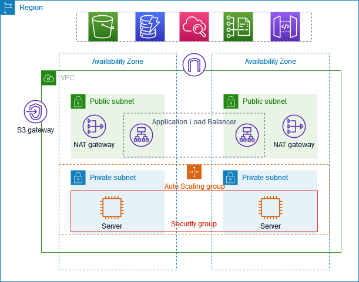

# Day 4: Building a Secure Multi-AZ VPC with Auto Scaling and Load Balancing

This setup creates a production-style AWS architecture where web servers live in private subnets for security, while users access the application through a public-facing load balancer and a bastion host for controlled access.

## 1. Create a VPC with two Availability Zones

- Set up a VPC in a region of your choice.
- Make sure it spans 2 Availability Zones for high availability.
- Create public subnets and private subnets in both AZs.
- Enable a NAT gateway in the public subnets so instances in private subnets can access the internet for updates and package installation without being directly exposed.
- Configure route tables and security groups properly.

This gives the infrastructure both security and resilience.

## 2. Create an Auto Scaling Group

- Before creating the Auto Scaling Group, create a launch template.
- The launch template defines the EC2 instance configuration such as AMI, instance type, key pair, security groups, and user data scripts.
- Create an Auto Scaling Group that launches instances in the private subnets.
- Set the desired capacity to 2 instances for this example.
- Auto Scaling ensures that if an instance fails or traffic increases, new instances are created automatically.

The goal here is that the web servers are always available, but they remain protected in private subnets.

## 3. Verify the instances are running in private subnets

- After the Auto Scaling Group launches the instances, check whether both instances are healthy and running.
- Confirm they are placed in the private subnets rather than public subnets.
- This ensures they are not directly accessible from the internet.

## 4. Create a Bastion Host

- Create a public-facing EC2 instance called a bastion host.
- Place it in a public subnet so it can be accessed from outside the VPC.
- This bastion server acts as a secure gateway for connecting to the private instances.
- The private servers are not directly exposed to the internet, but the bastion host allows controlled access.

## 5. Connect to the private servers through the bastion host

- Log in to the bastion host.
- Use SSH to connect to the private EC2 instances from the bastion machine.
- Copy the key pair securely to the bastion host if needed.
- Deploy a simple HTML page or application on the private instances.

This step shows how application servers can remain private while still being manageable by administrators.

## 6. Create an Internet-Facing Load Balancer

- Create a load balancer that is internet-facing.
- Configure it to listen on port 8000, which is where the HTML app is being served.
- Create a target group and register both private EC2 instances as targets.
- This load balancer distributes incoming traffic to both instances.

This makes the application accessible to users while still keeping the backend servers private.

## 7. Test the application through the load balancer

- Once the load balancer is created, use its DNS name in the browser.
- Check whether the application loads successfully.
- If the setup works, the traffic is being routed through the load balancer to the private web servers.

## Summary

This architecture follows a secure AWS design:

- Public subnets handle internet-facing resources like the bastion host and load balancer.
- Private subnets host the application servers for protection.
- NAT gateways allow private instances to access the internet when needed.
- Auto Scaling keeps the application available based on demand.
- A bastion host provides secure administrative access.
- A load balancer ensures traffic is evenly distributed and the app remains reachable.

> Important: After finishing the setup, delete the AWS resources you created (especially the VPC, NAT gateways, security groups, internet gateway, and EC2 instances) to avoid unnecessary charges.

<!--
Step summary:
1. Create a VPC with 2 AZs and NAT gateway.
2. Create launch template and Auto Scaling Group.
3. Check EC2 instances in private subnets.
4. Create bastion host in public subnet.
5. SSH from bastion to private servers and deploy HTML app.
6. Create internet-facing load balancer and target group.
7. Register both private servers and test via load balancer DNS.
-->